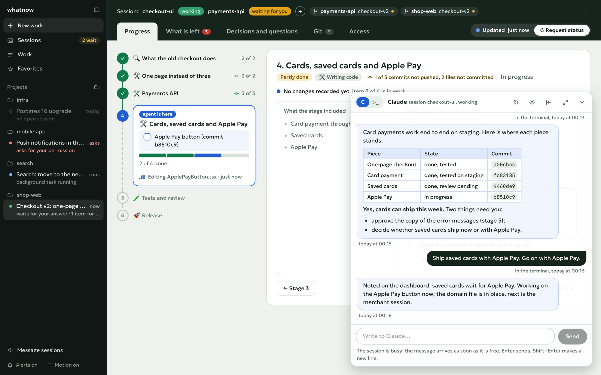
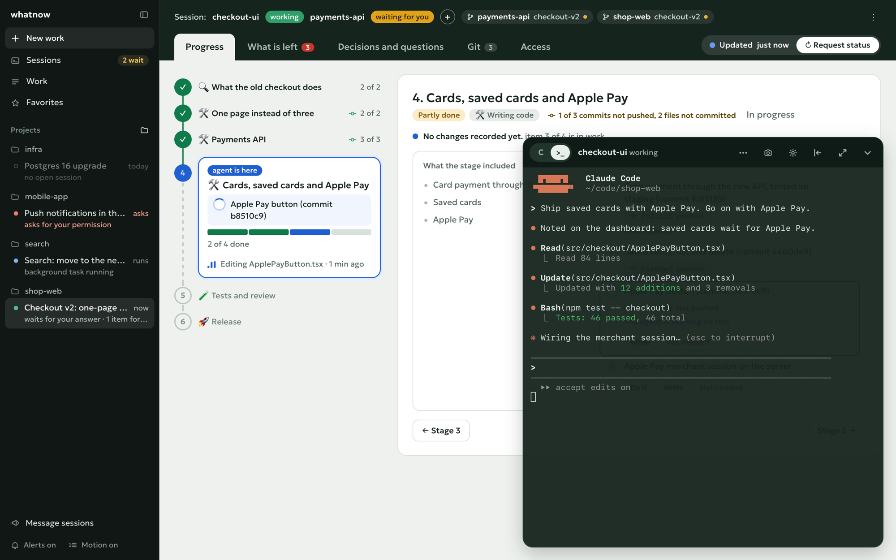
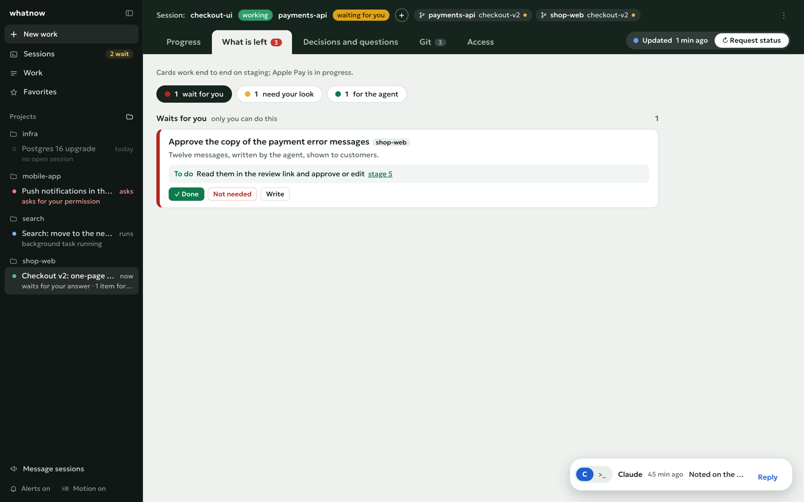
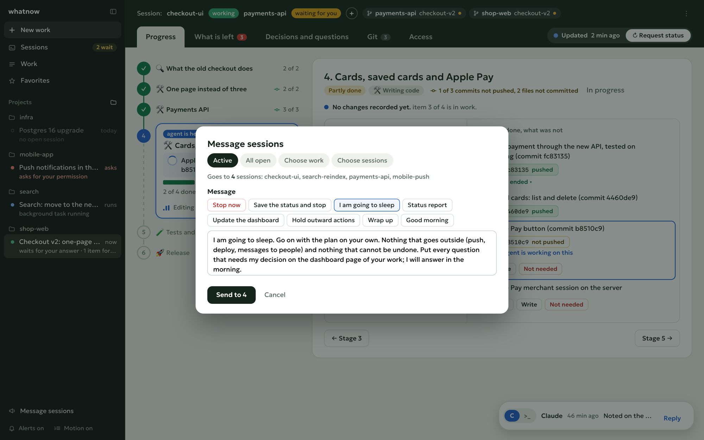
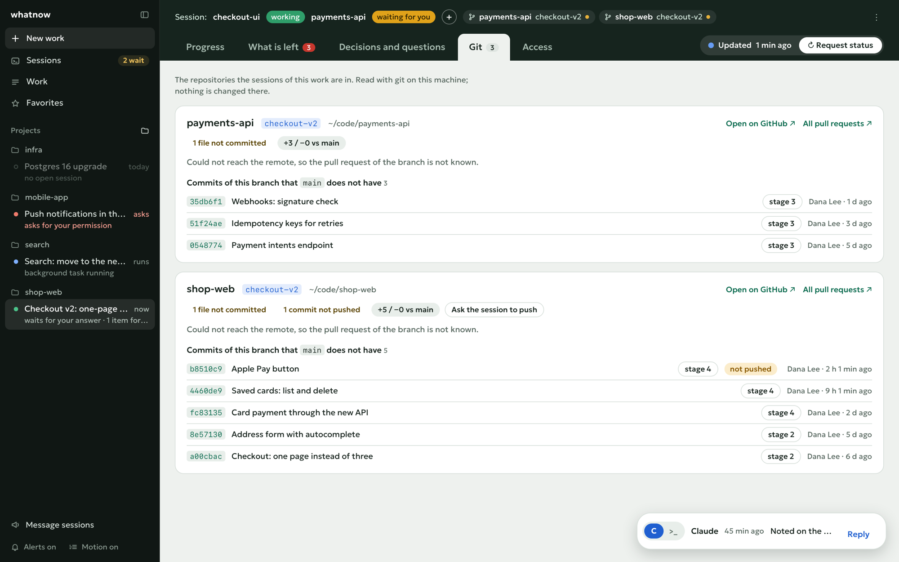
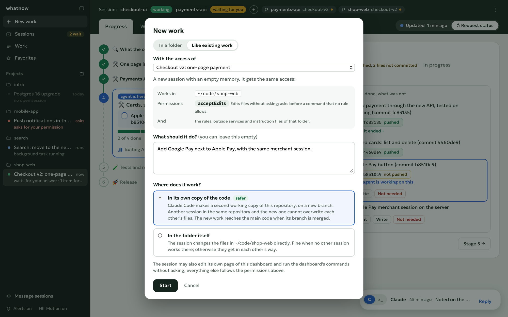
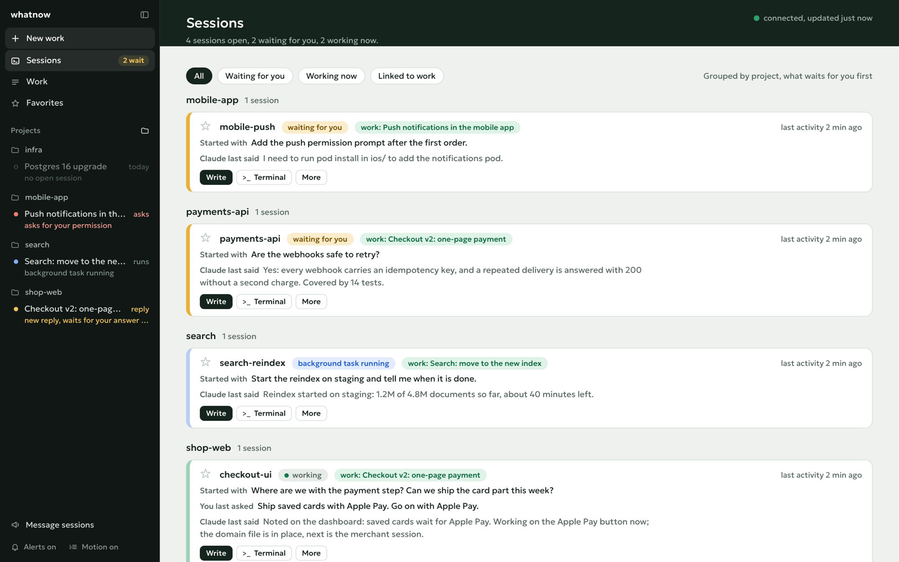

# whatnow

**One window for all your Claude Code sessions.** See which one works, which one waits for you and what each has
done, follow a large piece of work stage by stage across several repositories, and talk to any session — in a chat
or in its real terminal — without hunting for the right terminal tab.

It is made for engineers who run several pieces of work in parallel with Claude Code and want one place to look,
instead of reading long CLI transcripts. It shows progress, not tokens or costs. Everything runs on your machine.



## Highlights

### The session, next to its plan
Every work has a page: the stages of the plan, what was really done in each, and what is left. Over it floats the
window of the session that does the work. **Chat** shows the conversation, Markdown tables included, and the
messages you typed in the terminal too; **Terminal** is the session itself (`claude attach`), keys and all. You can
move the window left or right, make it full width, fold it to one line, or set its colors and see-through look.



### What waits for you, at a glance
The bar on the left groups works by project and says, in two short lines each, who has to act: *asks for your
permission*, *new reply*, *background task running*. **What is left** splits the open items into *wait for you*,
*need your look* and *for the agent*, each with *Done*, *Write* and *Not needed*. Alerts come as system
notifications with a sound; clicking one opens the work.



### Message every session at once
**Message sessions** sends one message to the active sessions, to all open ones, or to the works or sessions you
choose. Ready messages cover the usual moments: *Stop now* (a real stop, as Esc in the terminal, after you confirm),
*Save the status and stop*, *I am going to sleep* (go on alone, nothing that goes outside, questions on the
dashboard), *Status report*, *Good morning*. Sessions that sleep in the background are woken to read it. Going to
sleep yourself? It also asks how long to keep the computer awake: **Stay awake** in the bar holds off the system's
sleep for a few hours or until you turn it off, so the sessions work through the night.



### Git, read for you
The **Git** tab shows every repository the sessions of a work touch: branch, files not committed, commits not
pushed, the commits of the branch tied to the stages of the plan, and links to the repository and its pull
requests. It only reads; nothing is changed there.



### Start new work from the app
**New work** starts a Claude Code session in the background: in a folder you pick, or with the same access as an
existing work. You choose the permission mode and whether it works in the folder itself or in its own copy of the
code (a git worktree, so two sessions never overwrite each other's files). Its page appears at once.



### Every session in one list
**Sessions** is a table of your Claude Code sessions, grouped by project, what waits for you first: its state, its
work, what Claude last said, when, and buttons to write to it or open its terminal. Filters: waiting for you, working,
linked to a work, *without work*; and when it was last active (open now, today, yesterday, 7, 14 or 30 days), which
brings back closed sessions too, to resume them.



### And
- **Screenshots for Claude** (macOS): the camera button in the session window lets you select a part of the screen;
  the picture goes to the session as a file it can read.
- **Access** tab: the folders, outside services and permissions a work uses.
- Works in a browser too (`whatnow serve`), and on macOS, Windows and Linux.

*The screenshots show made-up projects, sessions and people.*

## What you see
- **Home page, Work**: one small card per work: its project, the percent of its plan that is done, its stages as a
  strip, the stage it is at, and what it waits for (you, a permission, a working or background session). The work
  where you were asked something last comes first, then the latest activity. Filters: needs you, active, not active,
  done, and when it was last active (today, yesterday, 7, 14, 30 days).
- **Feature page** (tabs: Progress, What is left, Decisions and questions): what was planned
  and what really happened, stage by stage; what is left and who has to act on it.
- **Buttons on every item**: *Do it*, *Write*, *Not needed*. They send your instruction or question into the
  Claude Code session that works on the feature (see below).

## Requirements
- Claude Code (tested with 2.1.329) and Go 1.26+ to build. The result is one program of about 10 MB.
- The desktop window uses the system WebView: WebKit on macOS, WebView2 on Windows (part of Windows 10 and 11),
  WebKitGTK on Linux (`libwebkit2gtk-4.1-dev`; without it `install.sh` builds the commands and the server only).
- Windows: run `install.sh` in Git Bash (Claude Code on Windows uses it too). Autostart there is an entry in the
  Run key of the user's registry.

## Install
Ready builds for macOS (one app for Apple Silicon and Intel), Windows and Linux (amd64, arm64) are made by the
`build` workflow in GitHub Actions and attached to a release for every `v*` tag. To build it yourself:
```sh
./install.sh        # copies skill/ into ~/.claude/skills/whatnow and builds ~/.claude/skills/whatnow/whatnow
./install.sh --app  # macOS: the same, and the desktop app into /Applications, closed and opened again if it runs
```
Then ask Claude to start a dashboard for a big piece of work (the `whatnow` skill does this). It writes
`~/.whatnow/features/<name>/feature.json` and builds the pages. Open them:

```sh
~/.claude/skills/whatnow/whatnow                    # the desktop window
~/.claude/skills/whatnow/whatnow serve 7777         # the same pages for a browser: http://127.0.0.1:7777/
~/.claude/skills/whatnow/whatnow render --index --open   # static files, rebuilt on demand
```

## How it works
```
feature.json  ->  whatnow render  ->  panel.html (feature page) + index.html (home page)
```
- The source of truth is one `feature.json` per feature. Claude writes it while it works (stages,
  blockers, evidence) following the rules in `skill/SKILL.md`. The format is described in `skill/SCHEMA.md`.
- `whatnow render` validates the data and **derives** everything that must not be typed by hand: stage colours,
  counts, percentages, "ready to release?", staleness. It refuses a "passed" without a note saying what
  was checked, and a blocker that points to a stage that does not exist.
- The percent comes from the stages of the feature's own plan: every stage weighs the same and counts by the
  share of its items that are done (partly = 0.5). Nothing is imposed on a feature: tests, review or deployment
  are stages or items only where its plan has them.
- A feature with no update for 3 days is marked as not updated recently.

## Live page, hooks and server
A static `index.html` only changes when it is rebuilt. For a page that updates itself and shows where work is
happening, there are two parts:

```
Claude Code hooks -> whatnow hook -> ~/.whatnow/sessions/*.json + events.jsonl -> whatnow serve / window -> page (polls every 3 s)
```
- `whatnow hook` is run by Claude Code on session events. It is silent, never blocks and always exits 0. It records
  the state of each session and the `git commit`, `git push` and test-run events (other commands are dropped).
  The text of your prompts is never stored.
- `whatnow serve` serves `http://127.0.0.1:7777/` and re-reads `feature.json` and the hook data on every request.
  It listens on 127.0.0.1 only. The desktop window shows the same pages without going through the network, and also
  serves them on the port when the port is free.
- A session is linked to a feature, never a branch or folder. It links itself the moment it touches the feature's files (edits `feature.json`, runs `whatnow render` on it) or takes a message from the dashboard. You can also click **Attach a session** in the header of the feature page and pick one from the list, open or closed. Links live in `~/.whatnow/bindings.json`.
  A session without a feature is shown in its project's card area as a session without a feature.

Install the hooks (backup, merge with your existing hooks, safe to repeat):
```sh
~/.claude/skills/whatnow/whatnow hooks install     # --dry-run shows the diff; "hooks uninstall" removes them
~/.claude/skills/whatnow/whatnow hooks print       # just print the hooks block
```
The hooks are: state tracking (async) on session start, prompt, Bash and file-edit tool use, stop, notification and session end;
a synchronous `--deliver` hook on prompt submit; and `--watch` hooks (`asyncRewake`) on stop and session start.
Hooks of an older install (`python3 .../hook.py`) are replaced. A `--nudge` hook on stop reminds a session that finished a turn without updating its feature file. It never chains (it skips turns caused by a stop hook), waits 30 minutes between reminders to one session, and can be turned off with `"nudge": false` in `~/.whatnow/config.json`.
`docs/hooks-settings.example.json` has a copy.

## The Sessions tab
The home page opens on **Sessions**: every open Claude Code session, grouped by project, newest first, whether or not it belongs to a feature. The list comes from `claude agents`, and what each session is about comes from its transcript (how it started, what you asked last, what Claude answered last), so a session shows up even before it has triggered a hook. Per session: **Write** (sends a message to that session; a closed session is resumed in the background), **Copy resume command**, **Attach to a feature**, and **Hide** for sessions that do not belong on the page (hidden ids are kept in `~/.whatnow/hidden.json`). Click the star on a session or a feature to put it in the **Favorites** tab (kept in `~/.whatnow/favorites.json`); a starred session stays there after it is closed. The **Features** tab is the portfolio of large features.

## Buttons on the feature page
On a feature page opened through the server every item of a stage has actions:
- **Do it**: a task. The text goes to the session that works on this feature.
- **Write**: your question or remark about the item. The answer comes back in the same session.
- **Not needed** (red: it drops the item): a decision with a reason. The page asks you to confirm; then it applies
  at once: the item is struck through and stops counting as
  unfinished. It is stored in `overrides.json` next to `feature.json` (Claude never writes that file, so the
  two cannot overwrite each other). It follows the item's text, not its position. **Restore** undoes it.

**A session that sleeps.** A message reaches an open session through its hooks: while it works, at the end of the
turn; while it is idle, through a watcher that Claude Code keeps for an hour. After that hour nothing listens. A
*background* session is then woken through its terminal: the dashboard attaches to it, types one line ("There is a
message for you from the whatnow dashboard.") and leaves; the hook of that prompt delivers the message. Nothing is
typed when the screen of the session shows a question (Enter would answer it), and a session open in your own
terminal cannot be reached this way: there you type something yourself.

**Where *Do it* and *Write* go.** The message is written to `~/.whatnow/inbox/` and routed:
1. **A session of the feature is open** (confirmed by `claude agents --json`): the message is addressed to it.
   If it is idle, the `--watch` hook wakes it (`asyncRewake`: exit code 2 makes Claude Code start a turn).
   If it is busy, the message arrives when it finishes its answer. Without the watcher it arrives at your next prompt.
2. **Only a closed session is known:** the server runs `claude --resume <id> --bg "<message>"`. The session continues
   in the background under the same id with its old context. Watch it with `claude attach <id>`.
3. **No session is known:** the message waits for the first session that starts working on the feature.

**Closing an item yourself.** In **What is left** every item that waits for you ("Waits for you", "Needs your look") has
**✓ Done** and **Not needed** (this one after a confirmation). Either one applies at once: the item moves to "Closed by you" with your note, stops
counting as open, and the session of the feature is told, so that it records it in `feature.json` (a fact with your
word as the evidence, or a decision). **Restore** undoes it.

**What changed since you last looked.** When the plan of a feature gets new items, new plan lines, a new stage or new
open items, the page says so on top ("The plan changed since you last looked"), marks the stages with the number of
changes and makes the changed items glow for a few seconds; **Show** leads to the first of them. "Last looked" is kept
per feature in the browser. The page is not loaded again for this: it takes the new data and redraws in place.

**Motion.** The switch at the bottom of the bar chooses how the pages animate: **on** (the default: changes are
animated whatever the system says), **as the system** (nothing moves when the system asks to reduce motion) and
**off**. It is kept in the browser. What moves, each in 0.2 to 0.4 seconds: a new item slides in with a yellow edge
that fades; an item that became done gets one ring around its check; its segment of the strip fills and the count
rolls; the note about a changed plan fades in; a counter that changed gives one pulse. Under the current stage, while
its session works, three small bars and a line say what the agent does now ("editing git.go", "running go test"): the
hook writes the file an edit touched and the program a command ran, never the arguments. The variants these were chosen
from are on `/demo/motion`.

A session that keeps a
dashboard is reminded at every prompt to write new work into the plan before it starts (`"remind": false` in
`~/.whatnow/config.json` turns the reminder off), so a request you make shows up at once.

**New work.** *Work* is what the pages call one thing you and Claude are doing: a feature, a migration, a review.
(In files, addresses and commands it is still `feature`: `feature.json`, `/f/<slug>/`.) **+ New work** in the bar
starts one: a new Claude Code session in the background.
- *In a folder*: the folder you name (the app window has a dialog for choosing it) and the permission mode you pick.
- *Like existing work*: the folder that work was started in, its added folders and its permission mode; the rules, MCP
  servers and instruction files of the folder come with the folder. The same form opens from the three dots of a
  piece of work, in its header and in the bar.
- *From a repository*: the address of a repository (`https://host/owner/name`, `git@host:owner/name.git`) and the
  folder to clone it into. You choose that folder, and it is remembered; the dashboard has no folder of its own for
  code. The clone is made with your own git access, and nothing is asked: a repository that needs a password typed
  fails with a message, clone it once in a terminal then. A repository that is already cloned there is not cloned
  again, and a folder of that name that is something else is left alone. Only http(s) and ssh addresses are taken.

The dashboard opens the page of the new work itself, at once, and links the session to it: named after the task (its
first words) or, when you give none, after the folder. With a task the session rewrites the page with its plan;
without one it starts and waits for you to write to it there. The page is in `~/.whatnow`, outside the folder the
session works in, so the session is started with a permission to read the instructions of the dashboard, to edit
that one page and to run the dashboard's commands (`--allowedTools`); without it Claude Code would stop and ask, in a
terminal nobody may be looking at. Everything else follows the permission mode: in a mode that asks, the session
still stops for its other questions, and the bar and the alerts say so. For a git repository you choose where the
session works: in its own copy of the code (a worktree on a new branch, made by Claude Code, so two sessions cannot
overwrite each other's files) or in the folder itself. Claude Code works only in a folder you have trusted: for a new
one it refuses, and the form tells you to run `claude` there once and accept its question (the dashboard does not
answer that for you). What a session was started with is kept in `~/.whatnow/spawned.json`.

**Message sessions.** At the bottom of the bar: one message to several sessions at once. Who gets it: *Active*
(working now or active in the last hour), *All open*, the sessions of chosen work, or chosen sessions; the form names
them before you send. Ready-made messages fill the field (Stop now, Save the status and stop, I am going to sleep,
Status report, Update the dashboard, Hold outward actions, Wrap up, Good morning) and can be changed before sending.
A working session reads a message when its turn ends, so *Stop now* also stops the background sessions at once, as
Esc in their terminal does, after a confirmation that says what this cuts off; a session open in your own terminal
cannot be stopped from here and gets the message when its turn ends. With *I am going to sleep* the form also asks
how long the computer stays awake (8 hours unless you change it).

**Finish a work.** *Finish the work…* in the ⋮ menu of a work (in the bar or in the header of its page) asks first
and says what happens: its background sessions are stopped (what they do at that moment is cut off), sessions open
in your own terminal cannot be closed from here and are named so you close them yourself, and the plan and its
history stay. The work leaves the bar and is kept in Work, under **Completed**; its page says when it was finished,
and *Reopen the work* in the same menu brings it back. Finished works are kept in `~/.whatnow/closed.json`, not in
`feature.json`, so a session that rewrites its plan cannot undo it.

**A work in a window of its own (app window).** *Open in a separate window* in the ⋮ menu of a work (in the bar
or in the header of its page) opens that work in a second window, for another monitor: on macOS it has its own icon
in the Dock. It shows only that work, with its session window, chat and terminal, and reads the same data as the main
window. The bar of the main window marks the work with ⧉; a click on it brings its window to the front. **Back to the
main window** (in the separate window, or in the ⋮ menu of the work in the bar) closes it and shows the work in the
main window. Each separate window comes back where it stood and at its size. One session can be in the terminal of
both windows at once: they show the same screen and type into the same session.

**How full the context is.** Every session shows how full its context window is: a column in Sessions, a meter in
the title of the session window. It is read from the transcript as Claude Code counts it for its status line (the
input of the latest reply: input + cache creation + cache read), against the window of the model: 1M tokens for the
Fable models, Opus 4.7 and later, Sonnet 5 and later, Haiku 5.5 and `[1m]` models, 200K for the others. From 60% the
session window says so, with **What to do**:
- *Compact now, keeping what matters*: the session gets `/compact` with what to keep, written from the page of the
  work (editable). Claude Code compacts by itself anyway at about 967K of 1M; this way you choose what stays.
- *Continue in a fresh session*: a new session with the same access starts from the page of the work; the old one is
  stopped.
- *Summarize only the older part*: the terminal of the session opens, for `/rewind` and "Summarize up to here".
- *Clear and go on from the page*: `/clear`, then the session reads the page of its work and goes on.
- *Not now*: asked again at 85%.

A background session gets the command typed in; a session open in your own terminal gets the command shown to paste.

**Workspaces.** What a new session starts with, kept to pick in **New work → From a workspace**: its main folder and
the other folders it reaches, its permission mode, rules it may follow without asking (like `Bash(npm test:*)`), the
skills to use and a few lines of context, which open its first message. Made in *Edit workspaces…*, or from the
menu ⋮ of a work: *Save its access as a workspace*. Kept in `~/.whatnow/workspaces.json`.

**Stay awake.** At the bottom of the bar: the computer does not go to sleep by itself for 1, 2, 3 or 8 hours, or until
you turn it off; the bar shows the time left. With *Keep the screen on too* (the default) the screen stays on as well,
as while a video plays, so the computer does not look asleep. Closing the lid, the power button or Apple menu →
Sleep still send it to sleep: with the hold on it keeps running in the background with the screen off until the time
is over (a laptop on battery with its lid closed sleeps fully). The hold ends with the app; the
time is kept in `~/.whatnow/awake.json`, so the app started again takes up what is left. On macOS it is the system's
`caffeinate`, on Linux `systemd-inhibit`, on Windows `SetThreadExecutionState`.

**Attach files (app window).** The paperclip in the field of the session window opens the system dialog; files can
also be dropped on the window, and a picture pasted into the field. They are kept with the work (in
`~/.whatnow/shots/<work>/`, 50 MB a file), shown in the row above the field (a picture as a picture, anything else
by its name), and go with the next message as paths (`Attached file: …`), which Claude opens itself. In the terminal
view the path is typed into the prompt of the session.

**Screenshots for Claude (app window, macOS).** The camera in the title of the session window takes a part of the
screen (the system selection, as Cmd+Shift+4; Space picks a window). The picture is kept with the work in
`~/.whatnow/shots/<work>/` and shown in a row above the message field; a picked one (blue ring) goes with your next
message as its path, and Claude opens it itself. A new screenshot is picked at once; in the terminal view its path is
typed into the prompt of the session. Double click shows it large, × deletes it. macOS asks once to allow whatnow to
record the screen. Only the app window can take or see the screenshots.

**Alerts (app window).** When a session answers, or asks for a permission, while the app window is not in front,
the system shows a notification with the name of the feature and the first words of the answer, and plays a sound.
The bar has the switch: *with sound*, *silent*, *off* (`alerts` in `config.json`). A reply you have not read in the
window of its session is marked in the bar (a speech mark, "new reply"), also for the feature you are on. On macOS
the notification is shown through `osascript`, so the system lists it under Script Editor; on Linux through
`notify-send`; on Windows there are no alerts yet.

**Request status.** The header of a feature page has a **↻ Request status** button next to "Updated ... ago". It asks the
feature's session (same routing as above) to compare `feature.json` with what it really did and bring the page up to
date. Only one such request is open at a time; the page reloads itself when the file changes.

**The bar on the left.** Every live page has a bar on the left: **Sessions**, **Features** and **Favorites** (the
views of the home page, which has no tabs of its own), then all features in groups: favorites, the ones a session works on right now, the rest, finished ones.
One click opens another feature. The dot and the line under a name show what its session does. A feature whose
session wrote something and now waits for your answer is marked with 💬 (✋ when Claude asks for a permission).
While you have not opened that feature since the reply, the row is highlighted, the mark has a red dot, and the
browser tab title starts with the number of such features. "N items for you" counts the open items of the feature that only you can do. The arrow at the
top collapses the bar to a narrow strip (remembered); on a narrow screen it becomes a row of chips.

**The window of the session.** A feature page keeps the session of the feature in the bottom right corner, folded to
one line: its latest reply, or your message that is on its way. A new reply comes out of that line as a bubble with
its first lines, stays for eight seconds and folds back; a red dot stays on the line until you open the reply (what
Claude notes while it still works does not pop up). **Reply** on the line, or the bubble, opens the window of
the session. It has two views, and the switch in its corner (**C** for the messages, **>_** for the terminal) goes
from one to the other; the switch is on the folded line too.
- *Messages*: the recent conversation of the session read from its transcript (what you typed in the terminal, what
  Claude answered) and a field to write to it. Messages are shown as Markdown: tables (a wide one scrolls
  sideways), lists, code blocks, quotes, links. A message goes to that session like one from the Sessions tab, and its
  delivery state shows under it. A red dot marks a reply you have not opened yet.
- *Terminal* (app window only): the session itself, live (xterm.js on a pseudo-terminal that runs `claude attach`).
  The folded line then shows the name of the session and the last line of its terminal.

Drag the top or left edge of the window to resize it (double click an edge to reset). The arrows in its corner stretch
it along the bottom of the screen and back; the chevron folds it to a line (nothing is closed by that). The compact window
is moved along the bottom by its title row, and the arrow with a bar throws it to the other side. A text you typed and did not send (in the window, in the form of an item, in a message to a session) is kept
when you go to another page or close the app. The size and the place are remembered, the view is remembered for every feature, and a
terminal view that was open is opened again when you come back, also after the app was closed.

**Terminal (app window only).** On the page of a feature the terminal is the second view of the window of the
session (the **>_** half of its switch). On the home page every session has a **Terminal** button; it opens the terminal
in a window in the corner, with the colour chosen for the session window (the top edge resizes it, **Hide** keeps it
connected). The home page shows only what was opened on it, never a terminal by itself. A terminal that was already
running elsewhere is asked to draw its screen again when it is shown, so you see its screen now rather than a replay
of its history. A terminal stays connected while you are on
other pages and in the other view. **Disconnect the terminal** (behind the three dots, so that it is not hit by
accident) closes it; the session goes on
either way. A session can be shown when it runs in the background:
- it already does (`claude --bg`): the terminal attaches at once;
- it is closed: it is continued in the background under the same id (`claude --resume <id> --bg`), then attached;
- it is open in another terminal: nothing can take it from there. The window asks you to type `/background` in that
  terminal and attaches by itself when the session has moved. Claude Code gives a moved session a new id; its
  feature and its star follow it.

Shift+Enter is a new line, as in a terminal set up for Claude Code. A web address in the terminal (and any outside
link on a page) opens in your browser.

The terminal is full access to your machine, so it is never served on the 127.0.0.1 port: a browser tab does not get
it. On Windows it runs in a pseudo console (ConPTY, Windows 10 1809 and newer); that part is covered by a test on a
Windows build machine and has not been tried in the app window by a person yet.

**Folders and resources.** The Access tab shows, for every session, the folder it works in, the folder it was
started in (the agent reaches everything under it), the folders added to it (`--add-dir`, `/add-dir`) and the others
it worked in lately; these come from the environment snapshots Claude Code writes into the transcript. For an open
session its head there also shows the CPU (percent of one core) and memory its process takes together with
everything started under it; the Sessions list shows the same. Not read on Windows yet.

**How a step ended.** An item of a stage can carry a detail, and a stage a result (see `skill/SCHEMA.md`): what was
done, the important details and numbers, what was checked, what is left, the way an agent sums up its work in the
terminal. On the Progress tab **How it ended** under an item opens its detail, and the result of the stage is shown on
top of it. The agents are told to write them for every finished item and stage.

**Plan and commits.** An item that names a commit (`commit 3f2a9c1`) gets a chip with that commit, which says whether
it is pushed and leads to it on the Git tab; there the commit has a **stage N** link back to the item. An item that is
not done and speaks of a commit, a push or a request is marked "planned".

**What is left** shows one group of open items at a time: the groups ("wait for you", "need your look", "for the
agent", "later", "closed by you") are sub-tabs with their counts.

**The Git tab.** A feature whose sessions work in a repository gets a **Git** tab (a feature without one does not).
It has a block per repository, found from the folders the sessions worked in and remembered in `repos.json` next to
`feature.json`:
- the branch, files in no commit, commits not pushed, and how far the branch is from the main one (`+3 / −1 vs main`);
- the pull request (GitHub) or merge request (GitLab) of the branch with a link, and whether it is merged; when there
  is none, a link to create it;
- the commits of the branch that the main one does not have (on the main branch: the latest ones), each with a link,
  marked "not pushed" and "this feature" (made by a session of the feature, as the hook saw it);
- a warning when other sessions are in the same repository right now;
- **Ask the session to push** and **Ask the session to open it** send that request to the feature's session.

Everything is read with plain git on your machine, with your own keys and credential helpers; nothing is written to a
repository and git's optional locks are not taken. The requests are found without any extra program: GitLab publishes
merge requests as `refs/merge-requests/N/head` and GitHub pull requests as `refs/pull/N/head`, which also tells the two
apart on a self-hosted server. The remote is asked at most once in two minutes per repository. The tab counts unpushed
commits and repositories with uncommitted files.

**The Access tab.** A feature that has a session gets an **Access** tab: for every session of the feature, what it may
do and reach.
- **Permission mode** (`default`, `acceptEdits`, `plan`, `auto`, `bypassPermissions`) with what it means, and the model.
- **Folders**: where it works, where it was started (it reaches everything under that), added folders.
- **Rules from the settings files** that apply to it: your settings (`~/.claude/settings.json`), the project's
  (`.claude/settings.json`) and the local ones (`.claude/settings.local.json`) of the folder it was started in, as
  "Never", "Asks first" and "Allowed without asking".
- **Outside services (MCP servers)**: the ones in use with the number of their tools, and the ones offered but not
  signed in.
- **Instruction files it loaded** (`CLAUDE.md`, memory) and **the tools it has used**.

The mode, the model, the servers, the files and the tools are what Claude Code itself wrote into the transcript of the
session; the rules are read from the settings files. The tab only shows them, it changes nothing.

**Background task running.** A session that ended its turn while a background command or agent is still running does
not wait for you: it goes on by itself when the task ends. Claude Code reports such a session as busy, and the pages
show it as "background task running" instead of "waiting for you".

When Claude has handled a message it runs `whatnow inbox resolve <id> "summary"` and the summary shows on the page.

**Safety.** The page accepts writes only from the server's own page: `Host` and `Origin` are checked, the body must be
JSON, a custom `X-Whatnow` header is required (a site in your browser cannot send it without a CORS preflight, which
the server never allows) and the body size is limited. `claude` is started without a shell: your text is passed as one
argument and is never concatenated into a command.

## Autostart
```sh
~/.claude/skills/whatnow/whatnow autostart install      # --dry-run; also "autostart status", "autostart uninstall"
```
- macOS: a LaunchAgent `~/Library/LaunchAgents/whatnow.server.plist`. Linux: a systemd user unit
  `~/.config/systemd/user/whatnow.service`. Other systems: not supported, start the server by hand.
- The service runs `whatnow serve <port>`. `./install.sh` restarts it after every new build.
- Logs: `~/.whatnow/server.log`.

## Configuration
`~/.whatnow/config.json` (all keys optional):
```json
{"featuresDir": "/path/to/features", "aliases": {"repo-folder-name": "project-name"}, "port": 7777, "claudeBin": "/path/to/claude"}
```
- `featuresDir` (or `$FEATURES_DIR`): where the features live. Default `~/.whatnow/features`.
- `aliases`: use when a repository folder is not named like the project in `feature.json`.
- `claudeBin`: path to the `claude` executable, for a service whose PATH is short.
- `gitHosts`: `{"git.example.org": "gitlab"}` (or `"github"`), only for a server whose kind the Git tab cannot tell.
- `remind`: `false` stops the reminder to write new work into the plan; `nudge`: `false` stops the one after a turn.
- `$WHATNOW_HOME` changes the root (`~/.whatnow`).

## Files
- `skill/SKILL.md`: instructions for Claude: when and how to keep a dashboard, the honesty rules.
- `skill/SCHEMA.md`: the `feature.json` format.
- `skill/template.html` is the feature page, `skill/template-index.html` the home page, `skill/side.js` the bar on the left,
  `skill/term.js` the terminal; `skill/vendor/` holds xterm.js (MIT) and the Geologica font (SIL OFL 1.1): the pages take the font from the
  program itself, so a page does not wait for another server.
  They are embedded into the program (`assets.go`).
- `app/`: the program. `render.go` validation, derivation and page building; `server.go` the live pages and buttons;
  `hook.go` the hooks; `cli.go` the commands; `term.go` the terminal; `transcript.go` reading session transcripts; `main.go` the window.
- `app/*_test.go`: the tests.
- `examples/csv-export.json`: a complete example with made-up data.
- `install.sh`: copies `skill/` into `~/.claude/skills/whatnow`. Edit the files here, then run it again.

## Tests
```sh
go vet ./app
go test ./app
```

## Limitations
- Hooks follow the format in the Claude Code documentation. Some paths (for example resuming a closed session
  from a service) depend on your Claude Code version and macOS permissions.
- Delivery into an open session needs the hooks to be installed and the session to belong to a feature.
- The dashboard shows only what was written into `feature.json` and what the hooks saw. It does not read your code.
